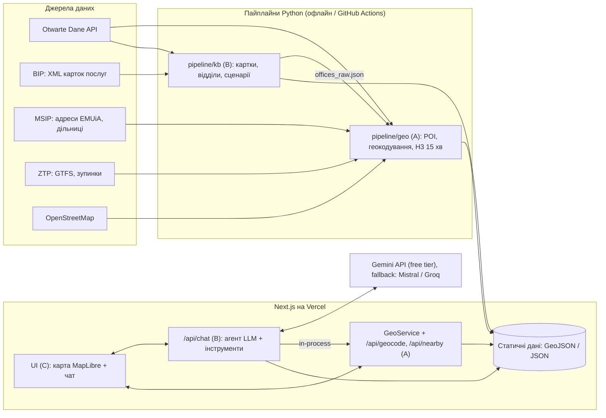

# Oswój Kraków — план реалізації

> Конкурс «Open Data App» (Gmina Miejska Kraków, COI UMK). Команда — 3 особи, кожен працює **зі своїм AI-агентом окремо**.
> Цей файл — єдине джерело правди для людей і агентів. Агентам обов'язково: §0, §3.2, §5 і свій розділ у §6.
> Стан на 18.10.2026.

---

## 0. Коротко

**Що робимо.** «Oswój Kraków» — веб-застосунок: AI-асистент (PL / UA / EN) + інтерактивна карта. Новий мешканець питає своїми словами («Де зробити PESEL?», «Що є поруч з ul. Wielicka 28?»). Асистент відповідає **лише на основі офіційних даних міста**, завжди з посиланням на джерело, а карта одразу показує установи, відділи урядів і зону досяжності.

**Вау-фіча.** «Kraków w 15 minut»: для будь-якої адреси показує, що досяжно за 15 хв пішки або пішки + KMK, і рахує «Indeks 15 minut».

**Ключові дати**

| Дата | Що |
|---|---|
| пн 19.10 | Каркас репозиторію + контракти змерджені (після цього всі працюють паралельно) |
| чт 22.10 | **Sync 1** — «тонкий зріз» працює наскрізно |
| **пт 23.10, до 14:30** | Реальний останній момент віднести підписану форму на ul. Basztowa 20. Формальний дедлайн 25.10 — неділя, а за регламентом документи приймають пн–пт 8:00–14:30 (див. §11) |
| вт 27.10 | **Sync 2** — «15 хвилин» наскрізно |
| пт 30.10 | **Sync 3** — MVP завершено |
| **нд 01.11** | **Feature freeze** — далі лише виправлення і документація |
| **ср 04.11** | Відправка роботи (буфер 1 день) |
| чт 05.11 | Крайній термін здачі (konkursopendata@um.krakow.pl) |
| ~19.11 | Список топ-10 (II етап) |
| **пт 27.11** | Фінал: 5 хв пітч + 5 хв питань |

**Три потоки робіт** (одна людина + один агент на потік):

- **A — Geo & Data**: місця на карті, геокодування, дільниці, транспорт, «15 хвилин» (Python + TS `GeoService`).
- **B — Knowledge & AI**: картки послуг BIP → база знань, сценарії, LLM-агент та інструменти, eval.
- **C — App/UX & Delivery**: Next.js-застосунок, карта, чат-UI, i18n, деплой, документація, пітч.

**Головні рішення** (деталі в §4): Python-пайплайни генерують статичні JSON/GeoJSON → Next.js на Vercel **без бази даних** · Gemini (free tier) через Vercel AI SDK з резервним провайдером · RAG без векторної БД · «15 хвилин» — передрахунок на сітці H3 · MapLibre + OpenFreeMap · усе безкоштовне.

---

## 1. Що вимагає регламент і як ми на це відповідаємо

### 1.1 Обов'язковий склад здачі (§5 регламенту)

Якщо бракує будь-якого елемента, роботу можуть відхилити.

1. Tytuł projektu.
2. Opis projektu oraz jego celu — **макс. 2 сторінки, PDF**.
3. Demo rozwiązania — działająca aplikacja lub prototyp.
4. Instrukcje uruchomienia.
5. Dokumentacja techniczna: a) технології, b) використані дані, c) архітектура, d) можливості розвитку.

Надсилаємо електронно на **konkursopendata@um.krakow.pl** до 05.11.2026. Формальна умова — використано хоча б одне джерело відкритих даних Кракова (у нас їх понад 12).
Ліцензія (§8): місто отримує невиключну ліцензію на презентацію роботи. **Код і технічна документація лишаються нашими** (§8.2) і підпадають під конфіденційність (§7).

### 1.2 Критерії I етапу → що робимо

| Критерій | Вага | Наша відповідь |
|---|---|---|
| Wpływ na miasto | **30%** | Реальна проблема: на 31.12.2025 у місті зареєстровано 15 008 іноземців на тимчасове перебування і 5 766 на постійне, громадяни понад 130 країн; у BIP 639 карток послуг. Ефект: менше «порожніх» візитів в уряди; карта прогалин «15 хвилин» для планування міста |
| Użycie danych | **20%** | Понад 12 датасетів порталу + MSIP + GTFS ZTP + OSM. **Кореляції**: процедура → відділ → адреса → доступність; адреса → комірка H3 → установи; дільниця → статистика мешканців/іноземців/установ |
| Innowacyjność | 15% | Чат, що «малює» на карті; 15-хвилинна доступність довільної адреси з GTFS; відповіді з цитатами офіційних карток |
| Architektura techniczna | 15% | Static-first + serverless, ETL з офіційного API, типізовані контракти, тести, eval-набір, незалежність від LLM-провайдера, шлях до PostGIS |
| Potencjał biznesowy | 10% | B2G (портали міста, обслуговування мешканців); B2B (роботодавці BPO/IT, релокаційні агенції, університети, портали нерухомості — віджет «Indeks 15 minut»); тиражування на інші міста |
| UX | 5% | Mobile-first, 3 мови, підказки-стартери, WCAG 2.1 AA |
| UI | 5% | Бренд «Oswój Kraków», shadcn/ui, єдині іконки категорій |

II етап: презентація (0–10) + відповіді на питання (0–10). **Фінальний бал = 70% I етапу + 30% II етапу.**

---

## 2. Продукт

### 2.1 Для кого — усі нові мешканці

| Персона | Ситуація | Що питає | Що використовує |
|---|---|---|---|
| Ola, 29, з Гданська (PL) | Нова робота, орендує квартиру | zameldowanie, перереєстрація авто, садочок | SA-14, KM-8, przedszkola, «15 хв» |
| Андрій, 36, з Харкова з донькою 5 років (UA) | Тимчасовий захист | PESEL UKR, zameldowanie cudzoziemca, przedszkole, робота | SA-65, SA-12, GUP-1/2, MOPS-21 |
| Priya, 27, IT-фахівчиня з Індії (EN) | Контракт у Кракові | zameldowanie, PESEL, karta pobytu (не міська компетенція), транспорт | SA-12, SA-34, офіційне посилання на Urząd Wojewódzki, KMK |
| Lukas, 22, студент Erasmus (EN) | Семестр в AGH/PK | zameldowanie, бібліотеки, транспорт | SA-12, biblioteki, przystanki |

### 2.2 Функції (MoSCoW)

**Must (MVP до 01.11)**

- **M1** Чат-асистент PL/UA/EN: стрімінг відповіді, підказки-стартери, посилання на джерела.
- **M2** Процедури: пошук серед 639 карток BIP. Картка процедури містить документи, оплати, термін, місце подачі, години роботи, кнопку «Umów wizytę» і посилання на BIP. Відділи показуються на карті.
- **M3** Карта: щонайменше 10 шарів (żłobki, kluby dziecięce, przedszkola, szkoły podstawowe, szkoły ponadpodstawowe, biblioteki, parki, kluby rodziców, przystanki KMK, urzędy), фільтри, попапи з даними і джерелом.
- **M4** «Kraków w 15 minut»: адреса або клік на карті → зона пішки та пішки + KMK → кількість установ за категоріями, індекс, найближчі місця. Доступно і з чату, і окремою кнопкою.
- **M5** «Pierwsze kroki»: щонайменше 5 сценаріїв-чеклістів із посиланнями на процедури.
- **M6** UI трьома мовами, mobile-first, публічний URL.
- **M7** Документація за §5 регламенту.

**Should**

- **S1** Шар «Indeks 15 minut» для всього міста — карта прогалин як сильний аргумент для міста.
- **S2** Профіль дільниці: мешканці, іноземці, кількість установ.
- **S3** 8 сценаріїв замість 5.
- **S4** Eval-набір із 40+ питань і звіт якості.
- **S5** Кеш відповідей на стартові питання + резервний LLM-провайдер.
- **S6** Посилання для поширення результату (`?addr=…&mode=…`).
- **S7** Відео-демо 2–3 хв.
- **S8** Автооновлення даних через GitHub Action.

**Could:** семантичний пошук (embeddings) · експорт чекліста в PDF/.ics · лікарі POZ (API NFZ), якість повітря (GIOŚ), ціни житла (RCN MSIP) · анонімна статистика тем питань для міста · голосовий ввід.

**Won't (цього разу):** акаунти · нативний мобільний застосунок · запис на прийом від імені користувача · юридичні консультації · realtime-транспорт (GTFS-RT).

### 2.3 Демо-сценарій (мета всієї роботи — він має працювати бездоганно)

1. (UA) «Я щойно переїхав до Кракова з Харкова з донькою 5 років. З чого почати?» → сценарій `obywatel-ua` (чекліст) + відділи на карті.
2. (PL) «Gdzie mogę uzyskać PESEL i co muszę zabrać?» → картка SA-65 / SA-34: документи, термін, 3 відділи на карті з годинами + «Umów wizytę».
3. (PL) «Wynajmuję mieszkanie przy ul. Wielickiej 28. Co mam w zasięgu 15 minut?» → зона + przedszkola/żłobki/parki/przystanki. Перемикач «komunikacją» → зона росте.
4. (EN) «Which kindergartens near me are the biggest?» → список + маркери з номерами.
5. Шар «Indeks 15 minut» по місту → «ось де бракує żłobków» (аргумент для міста).

### 2.4 Принципи відповідей асистента

- Факти беруться **лише з інструментів** (картки BIP, дані міста). Кожна відповідь про процедуру має посилання на картку BIP.
- Питання поза компетенцією міста (karta pobytu → Małopolski Urząd Wojewódzki; NFZ; ZUS; податки): коротко пояснити, хто цим займається, і дати офіційне посилання з білого списку. Деталей не вигадувати.
- Відповідь — мовою користувача. Польські офіційні назви — в оригіналі з перекладом у дужках, щоб людина могла назвати їх в урядi.
- Якщо даних немає — так і сказати, дати посилання на BIP або контакт.
- Дисклеймер: це інформаційний сервіс, а не юридична консультація; не вводьте персональні дані.

---

## 3. Дані

### 3.1 Джерела

API порталу: `https://api.um.krakow.pl/<api>/v1/<table>`. Список таблиць API: `GET https://api.um.krakow.pl/<api>/v1/metadata`.

| # | Джерело | Доступ | Записів | Обробка | Потік |
|---|---|---|---|---|---|
| 1 | Lista usług administracyjnych i procedur zewnętrznych GMK | `opendata-administracja-lista-uslug-i-procedur/v1/uslugi-adm-procedury-zew-gmk` | 639 | → завантаження XML карток | B |
| 2 | Karty usług BIP (XML) | `https://www.bip.krakow.pl/uslugi/xml/{SYMBOL}` | 639 | парсинг секцій і відділів | B |
| 3 | Przedszkola — liczba dzieci (2025/26) | `opendata-oswiata-przedszkola-liczba-dzieci/v1/liczba-dzieci-przedszkola-{samorzadowe,niesamorzadowe}-2025-2026` | 136 + 350 | геокодування | A |
| 4 | Szkoły podstawowe — liczba uczniów | `opendata-oswiata-szkoly-podstawowe-liczba-uczniow/v1/…-2025-2026` (таблиці — через `/metadata`) | ? | геокодування | A |
| 5 | Szkoły ponadpodstawowe — liczba uczniów | `opendata-oswiata-szkoly-ponadpodstawowe-liczba-uczniow/v1/…` | ? | геокодування | A |
| 6 | Żłobki samorządowe / prywatne / na zlecenie GMK | `opendata-zdrowie-zlobki-samorzadowe/v1/zlobki-samorzadowe`, `opendata-zdrowie-zlobki-prywatne/v1/zlobki-prywatne`, `opendata-zdrowie-zlobki-gmk/v1/zlobki-zlecenie-gmk` | 22 / >100 / 11 | геокодування; є «Liczba miejsc» | A |
| 7 | Kluby dziecięce | `opendata-zdrowie-kluby-dzieciece/v1/kluby-dzieciece` | 21 | геокодування | A |
| 8 | Kluby rodziców z dziećmi do lat 3 | `opendata-kluby/v1/Kluby` | 50 | геокодування | A |
| 9 | Biblioteki (filie) | `opendata-kultura-lista-bibliotek/v1/biblioteka-krakow-filie` | 62 | геокодування | A |
| 10 | Parki miejskie / kieszonkowe | `opendata-srodowisko-parki-miejskie/v1/parki-miejskie-powierzchnia`, `opendata-srodowisko-parki-kieszonkowe/v1/parki-kieszonkowe-powierzchnia` | 78 / 44 | **координат немає** → OSM за назвою | A |
| 11 | Cudzoziemcy zameldowani (czasowy / stały) за дільницями і громадянством | `opendata-mieszkancy-cudzoziemcy-pobyt-{czasowy,staly}/v1/cudzoziemcy-zameldowani-na-pobyt-{czasowy,staly}-ob-31-12-2025` | 971 / 793 | агрегати по дільницях | A |
| 12 | Mieszkańcy zameldowani (czasowy / stały) за дільницями | `opendata-mieszkancy-pobyt-{czasowy,staly}/v1/zameldowani-na-pobyt-{czasowy,staly}-km-31-12-2025` | 36 / 36 | агрегати | A |
| 13 | Punkty adresowe EMUiA (MSIP) | `https://msip.um.krakow.pl/Dane/Adresy_JSON.zip` (оновлюється щодня) | 70 299 | **EPSG:2178** → 4326; основа геокодера | A |
| 14 | Dzielnice (MSIP) | `https://msip.um.krakow.pl/Dane/Dzielnice_JSON.zip` | 18 | перевірити CRS | A |
| 15 | KMK GTFS (ZTP) | `https://gtfs.ztp.krakow.pl/GTFS_KRK_{A,T,M}.zip` | — | r5py | A |
| 16 | Przystanki KMK, P+R (ArcGIS ZTP) | `https://services-eu1.arcgis.com/svTzSt3AvH7sK6q9/arcgis/rest/services/Przystanki_Komunikacji_Miejskiej_w_Krakowie/FeatureServer/0/query?where=1%3D1&outFields=*&f=geojson` | ~? | пагінація `resultOffset` | A |
| 17 | OpenStreetMap | Geofabrik `malopolskie-latest.osm.pbf` (або BBBike extract «Krakau»); Overpass | — | пішохідна мережа, полігони парків | A |
| 18 | Powierzanie pracy cudzoziemcom (GUP); Statystyki demograficzne | `opendata-przedsiebiorczosc-i-nauka/v1/oswiadczenia`; `opendata-mieszkancy-statystyki/v1/Statystyka_mieszkancy` | 44 / 31 | цифри для опису й пітчу | C |

Should/Could-джерела: Centra Aktywności Seniora (`opendata-spoleczenstwo-centra-aktywnosci-seniora/v1/cas-lista`), lista muzeów/teatrów, MSIP «ZIS Obiekty sportowe», MSIP RCN (WFS `https://geodezja.eco.um.krakow.pl/cgi-bin/krakow-rcn?SERVICE=WFS&REQUEST=GetCapabilities`), API NFZ.

### 3.2 Технічні нюанси — обов'язково для A і B

1. **Пагінація API порталу**: 100 записів на сторінку. Поле `nextLink` вказує на **внутрішній хост** `https://srv-app-querona:8081/api/<table>?$after=…`, тож його треба переписати на `https://api.um.krakow.pl/<api>/v1/<table>?$after=…`. Параметри `$skip` і `$top` не підтримуються (400).
2. **Брудні типи**: числа приходять як float (`1.08e+002`), телефони — як числа (`1.2411743e+008` → «12 411 74 30»), у полі `Miejscowość` на початку стоїть пробіл. Усе це треба нормалізувати.
3. **Координат майже ніде немає.** Геокодування робимо через EMUiA (MSIP) у такому порядку: точний збіг (нормалізована вулиця + номер) → fuzzy-збіг (rapidfuzz) → Nominatim (не частіше 1 запиту/с, з кешем) → `manual_fixes.csv`. Мета — щонайменше 95% місць із точністю «адреса». Звіт якості додаємо в документацію.
4. **CRS**: EMUiA (і, ймовірно, Dzielnice) — у **EPSG:2178** (PL-2000, зона 7). Перепроєктувати в EPSG:4326 (`pyproj`, `always_xy=True`). Поля EMUiA: `nazwa_ulicy`, `numer_adresowy`, `kod_pocztowy`, `numer_dzielnicy`, `nazwa_dzielnicy`.
5. **BIP XML** (схема `proc.xsd`): `Naglowek{Url,Urzad,Wydzial,Symbol,Tytul}`, `TrescUslugi/Element{Tytul,Tresc(HTML)}`, `ZalacznikiUslugi`, `Metka`. Секції:
   - Krótki opis usługi;
   - Kogo dotyczy usługa;
   - Kryteria dla realizacji usług;
   - Wymagane dokumenty;
   - Opłaty;
   - Miejsce przyjmowania dokumentów — таблиця з колонками Nazwa | Adres | Godziny otwarcia | Umówienie wizyty → `https://umawianiewizyt.um.krakow.pl/branch/N` | telefon;
   - Sposób realizacji usługi;
   - Informacje dodatkowe;
   - Termin załatwienia;
   - Odpowiedzialna komórka organizacyjna;
   - Podstawa prawna;
   - Załączniki.

   `robots.txt` дозволяє `/uslugi`. Краулимо **один раз**, ввічливо: 1 запит/с, кеш, `User-Agent` з контактом.
6. **Парки** в датасеті мають лише назву, дільницю й площу → полігони беремо з OSM (Overpass, `leisure=park`) з fuzzy-матчингом назв.
7. **GTFS**: 3 фіди (A — автобуси, T — трамваї, M — перевірити вміст). Дата відправлення для r5py має бути в межах `calendar.txt` / `calendar_dates.txt`.
8. **ArcGIS FeatureServer** віддає GeoJSON порціями (`exceededTransferLimit: true`), тож гортаємо через `resultOffset` / `resultRecordCount`. URL сервісу за id елемента: `https://www.arcgis.com/sharing/rest/content/items/<id>?f=json` → поле `url`.
9. Зупинки KMK охоплюють і агломерацію — фільтруємо межею Кракова (union дільниць).

### 3.3 Ліцензії та атрибуція

- Портал: «Warunki wykorzystania danych udostępnianych w portalu» → підпис «Źródło: Otwarte Dane Miasta Krakowa» + дата даних (у попапах і на сторінці «O danych»).
- BIP: посилання на картку в кожній відповіді.
- OSM: «© OpenStreetMap contributors» (ODbL). OpenFreeMap / OpenMapTiles — атрибуція на карті.
- MSIP, ZTP — підпис джерела на сторінці «O danych».

---

## 4. Архітектура і стек

### 4.1 Діаграма



### 4.2 Стек

| Шар | Технологія | Чому |
|---|---|---|
| Пайплайни даних | Python 3.12 + `uv`, httpx, pandas / geopandas, pyproj, shapely, h3, **r5py (потрібен JDK 21)**, osmnx (fallback), lxml, markdownify, rapidfuzz | Найкраща гео-екосистема; у команді є Python і ML |
| Застосунок | Next.js (App Router, TypeScript strict), Tailwind + shadcn/ui, next-intl | Один деплой; найкраще «вайбкодиться» |
| AI | Vercel AI SDK (`ai`, `@ai-sdk/google`, `@ai-sdk/mistral` або `@ai-sdk/groq`), zod | Tool calling, стрімінг, генеративний UI; зміна провайдера — один рядок |
| Карта | MapLibre GL JS (`react-map-gl`), OpenFreeMap (`https://tiles.openfreemap.org/styles/liberty`), Turf.js, h3-js | Безкоштовно, без ключів |
| Пошук | MiniSearch (у пам'яті) | 639 карток не потребують векторної БД |
| Тести | Vitest (TS), pytest (Python), Playwright smoke (Should) | — |
| Хостинг і CI | GitHub (публічне репо `grabych-jr3/oswoj-krakow`), GitHub Actions, Vercel Hobby (некомерційне демо — ок) | $0; preview-деплой на кожен PR |

### 4.3 Ключові рішення

1. **Static-first, без БД.** Усі дані read-only і невеликі: ≈2–3 тис. місць, 639 карток, ≈3 100 комірок H3. Вони лежать як JSON/GeoJSON у репо і завантажуються в пам'ять serverless-функції. Це $0, швидко, стабільно й легко тестувати. Шлях розвитку — PostGIS + pgvector, коли з'являться акаунти або realtime.
2. **Геокодування офіційними адресними точками EMUiA** (70 299 адрес) замість зовнішніх сервісів: точніше і додатково зараховується як використання міських даних.
3. **«15 хвилин» — передрахунок на сітці H3** (res 9, ≈0,1 км², ≈3 100 комірок у межах Кракова). Для кожної комірки r5py рахує, які місця досяжні за 15 хв пішки та пішки + KMK (GTFS + OSM, будній день 08:00, вікно 30 хв, медіана). У рантаймі — O(1) lookup, без зовнішніх API і лімітів. Fallback: тільки пішки (osmnx, 80 м/хв) + шар ізохрон ZTP.
4. **«Indeks 15 minut»** = 100 × (кількість базових груп у зоні) / 6. Групи: опіка 0–3 (żłobek або klub dziecięcy), przedszkole, szkoła podstawowa, zieleń (park або park kieszonkowy), biblioteka, przystanek KMK. Метод документуємо.
5. **RAG без векторної БД.** LLM сама формулює запит польською (параметр `query_pl` інструмента) → MiniSearch по назвах, описах і тегах карток → LLM обирає символ → `get_procedure` повертає секції. Відповідь будується лише з наданих секцій + посилання на BIP. Embeddings — це Could.
6. **LLM-незалежність.** Gemini free tier через Vercel AI SDK; провайдер і модель задаються змінними середовища. Автоматичний fallback на Mistral / Groq при 429 / 5xx, кеш відповідей на стартові питання, ліміт запитів на IP. Кожен розробник використовує свій ключ (окремі квоти).
7. **Генеративний UI.** Результати інструментів мають типізовані payload-и (§5.3) → UI малює їх на карті (маркери з номерами, зона, fitBounds) і в чаті (картки, чеклісти). Текст відповіді посилається на маркери номерами.
8. **Приватність і безпека.** Без акаунтів; історія чату зберігається лише в браузері; дисклеймер; ключі тільки на сервері; логи без персональних даних.
9. **Доступність.** Ціль — WCAG 2.1 AA: контраст, клавіатура, `aria-live` для чату, mobile-first.

### 4.4 Змінні середовища (`app/.env.example`)

```bash
LLM_PROVIDER=google                 # google | mistral | groq
LLM_MODEL=                          # актуальна Gemini Flash із free tier (перевірити в AI Studio)
LLM_FALLBACK_PROVIDER=mistral       # або groq
LLM_FALLBACK_MODEL=
GOOGLE_GENERATIVE_AI_API_KEY=
MISTRAL_API_KEY=
GROQ_API_KEY=
LLM_MOCK=0                          # 1 = скриптований стрім без LLM (розробка UI)
GEO_IMPL=real                       # mock | real
RATE_LIMIT_PER_MIN=10
```

---

## 5. Як працювати паралельно і не заважати одне одному

### 5.1 Принципи

1. **Спершу контракти, потім код.** У день 0 типи з §5.3 потрапляють в `app/src/contracts/` і заморожуються. Змінити їх можна лише окремим PR з префіксом `contract:` і апрувом двох інших.
2. **Кожна директорія має одного власника** (§5.2). Агент редагує тільки файли своєї зони. Якщо потрібна зміна в чужій зоні, агент зупиняється, а людина створює issue для власника.
3. **Споживач не чекає виробника.** Кожен працює з фікстурами й моками (§5.4) і перемикається на реальні дані змінною середовища.
4. **Пайплайни A і B обмінюються лише файлами** в домовлених місцях. Спільного Python-коду немає — невелике дублювання (наприклад, клієнт API порталу) допустиме.
5. **Імпорти між зонами — тільки через публічні входи**: `@/server/geo` (`index.ts`) і `@/server/agent/starters`. Глибоких імпортів немає.
6. **Маленькі PR щодня**; `main` завжди зелений і задеплоєний.
7. **Root-конфіги та `app/package.json` належать C.** Нову залежність додаємо окремим маленьким PR `deps:` (або просимо C). Усі очікувані залежності C ставить одразу в C0.
8. **Поки C0 не змерджено (пн 19.10), A і B нічого не створюють в `app/`**, бо `create-next-app` вимагає порожню директорію. До того часу вони працюють у `pipeline/*`.

### 5.2 Структура репозиторію і власники

```text
oswoj-krakow/
├── PLAN.md                        # спільне (PR + апрув)
├── AGENTS.md                      # спільне — правила для всіх агентів (шаблон: Додаток B)
├── CLAUDE.md                      # спільне — один рядок "@AGENTS.md" (для Claude Code)
├── README.md                      # C
├── .github/                       # C — CI, CODEOWNERS, перевірка зон
├── pipeline/
│   ├── geo/                       # A — uv-проєкт (свій pyproject і lock)
│   └── kb/                        # B — uv-проєкт (свій pyproject і lock)
├── content/scenarios/             # B — сценарії (YAML/MD, PL → переклади)
├── evals/                         # B — тестові питання + скрипт оцінки
├── docs/
│   ├── zgloszenie.md              # C — текст форми реєстрації
│   ├── opis.md                    # C — 2-сторінковий опис → PDF
│   └── tech/
│       ├── dane.md                # A
│       ├── ai.md                  # B
│       └── architektura.md, technologie.md, rozwoj.md   # C
└── app/                           # Next.js
    ├── package.json               # C (залежності — PR deps:)
    ├── data/geo/                  # A — згенеровано, server-only
    ├── data/kb/                   # B — згенеровано, server-only
    ├── public/data/layers/        # A — статичні шари для карти
    ├── scripts/validate-geo.ts    # A
    ├── scripts/validate-kb.ts     # B
    ├── messages/{pl,uk,en}.json   # C — тексти UI
    └── src/
        ├── contracts/             # 🔒 СПІЛЬНЕ — тільки через contract-PR
        ├── server/geo/            # A — GeoService
        ├── server/agent/          # B — LLM, промпти, інструменти, пошук, starters
        ├── app/api/geocode/       # A
        ├── app/api/nearby/        # A
        ├── app/api/chat/          # B
        ├── app/[locale]/…         # C — сторінки
        ├── components/, map/, lib/   # C
        └── …
```

**Таблиця зон** (її ж скопіювати в `AGENTS.md`):

| Зона | Шляхи |
|---|---|
| A — Geo & Data | `pipeline/geo/**`, `app/src/server/geo/**`, `app/src/app/api/geocode/**`, `app/src/app/api/nearby/**`, `app/public/data/layers/**`, `app/data/geo/**`, `app/scripts/validate-geo.ts`, `docs/tech/dane.md` |
| B — Knowledge & AI | `pipeline/kb/**`, `content/scenarios/**`, `evals/**`, `app/src/server/agent/**`, `app/src/app/api/chat/**`, `app/data/kb/**`, `app/scripts/validate-kb.ts`, `docs/tech/ai.md` |
| C — App/UX & Delivery | усе інше в `app/`, root-конфіги, `.github/**`, `docs/**` (крім файлів A і B), `README.md` |
| Спільне | `app/src/contracts/**`, `PLAN.md`, `AGENTS.md`, `CLAUDE.md` |

### 5.3 Контракти (C копіює дослівно в `app/src/contracts/` у C0)

```ts
// app/src/contracts/common.ts
import { z } from "zod";

/** [lng, lat] у WGS84 (EPSG:4326) */
export const LngLat = z.tuple([z.number(), z.number()]);
export type LngLat = z.infer<typeof LngLat>;

export const Locale = z.enum(["pl", "uk", "en"]);
export type Locale = z.infer<typeof Locale>;

export const SourceRef = z.object({
  dataset: z.string(),               // slug датасету порталу або "bip" | "msip-emuia" | "osm" | "ztp-gtfs" | "ztp-arcgis"
  url: z.string().url(),
  updatedAt: z.string().nullable(),  // ISO-дата стану даних
});
export type SourceRef = z.infer<typeof SourceRef>;
```

```ts
// app/src/contracts/place.ts
import { z } from "zod";
import { LngLat, SourceRef } from "./common";

export const PlaceCategory = z.enum([
  "zlobek", "klub_dzieciecy", "przedszkole", "szkola_podstawowa", "szkola_ponadpodstawowa",
  "klub_rodzica", "biblioteka", "park", "park_kieszonkowy", "przystanek", "park_and_ride", "urzad",
  // Should/Could:
  "centrum_seniora", "obiekt_sportowy", "muzeum", "teatr",
]);
export type PlaceCategory = z.infer<typeof PlaceCategory>;

export const District = z.object({ number: z.number().int().min(1).max(18), name: z.string() });
export type District = z.infer<typeof District>;

export const Place = z.object({
  id: z.string(),            // стабільний "<category>:<sourceKey>", напр. "przedszkole:rspo-3786"
  category: PlaceCategory,
  name: z.string(),
  address: z.string(),       // "ul. Młyńska Boczna 4, 31-470 Kraków"
  coords: LngLat,
  district: District.nullable(),
  phone: z.string().nullable(),
  url: z.string().url().nullable(),
  /** Атрибути за категорією:
   *  przedszkole/szkoła: { rspo, children|students, groups, public }
   *  żłobek/klub: { places, operator }   park: { area_ha, type }
   *  przystanek: { code, type: "A"|"T"|"AT" }   urzad: { hours, bookingUrl, procedures: "SA-34,SA-65" } */
  attrs: z.record(z.string(), z.union([z.string(), z.number(), z.boolean(), z.null()])),
  source: SourceRef,
});
export type Place = z.infer<typeof Place>;

export const DistrictStats = District.extend({
  residents: z.number().int().nullable(),   // zameldowani stały + czasowy (31.12.2025)
  foreigners: z.number().int().nullable(),  // cudzoziemcy stały + czasowy
  topCitizenships: z.array(z.object({ name: z.string(), count: z.number().int() })).max(5),
  placeCounts: z.record(z.string(), z.number().int()), // PlaceCategory → кількість
});
export type DistrictStats = z.infer<typeof DistrictStats>;
```

**Статичні файли (A → C):**

- `app/public/data/layers/<category>.geojson` — `FeatureCollection<Point>`; `properties` = `Place` без `coords`.
- `app/public/data/layers/index.json` — `{ generatedAt, categories: [{ category, count, updatedAt, source }] }`.
- `app/public/data/layers/districts.geojson` — `Polygon`; `properties` = `DistrictStats`.
- `app/public/data/layers/access-index.json` (S1) — `{ res: 9, cells: [[h3, scoreWalk, scoreTransit], …] }`.

```ts
// app/src/contracts/geo.ts
import { z } from "zod";
import { LngLat } from "./common";
import { District, DistrictStats, Place, PlaceCategory } from "./place";

export const TravelMode = z.enum(["walk", "transit"]); // transit = пішки + KMK
export type TravelMode = z.infer<typeof TravelMode>;

export const GeocodeResult = z.object({
  label: z.string(),                                  // "ul. Wielicka 28, 30-552 Kraków"
  coords: LngLat,
  district: District.nullable(),
  precision: z.enum(["address", "street", "approx"]),
});
export type GeocodeResult = z.infer<typeof GeocodeResult>;

export const NearbyResult = z.object({
  origin: z.object({ label: z.string(), coords: LngLat }),
  mode: TravelMode,
  minutes: z.number().int(),                          // MVP: 15
  area: z.object({                                    // GeoJSON Feature<Polygon | MultiPolygon>
    type: z.literal("Feature"),
    geometry: z.object({ type: z.enum(["Polygon", "MultiPolygon"]), coordinates: z.array(z.any()) }),
    properties: z.record(z.string(), z.any()),
  }),
  counts: z.record(z.string(), z.number().int()),     // PlaceCategory → кількість у зоні
  places: z.array(Place.extend({ minutes: z.number().nullable() })), // за хвилинами, ≤10 на категорію
  score: z.object({
    value: z.number().min(0).max(100),                // «Indeks 15 minut»
    missing: z.array(PlaceCategory),                  // яких базових груп немає в зоні
  }),
  method: z.string(),                                 // "r5py walk+transit, wt 08:00, GTFS 2026-10-16"
});
export type NearbyResult = z.infer<typeof NearbyResult>;

/** Реалізує A в app/src/server/geo/index.ts. Споживає B (інструменти агента). */
export interface GeoService {
  geocode(query: string, limit?: number): Promise<GeocodeResult[]>;
  findPlaces(q: {
    categories: PlaceCategory[];
    near?: LngLat;
    radiusM?: number;      // типово 1500
    district?: number;
    text?: string;         // пошук за назвою
    limit?: number;        // типово 10
  }): Promise<Array<Place & { distanceM: number | null }>>;
  nearby(q: { origin: LngLat; mode: TravelMode; minutes?: 15; categories?: PlaceCategory[] }): Promise<NearbyResult>;
  getPlace(id: string): Promise<Place | null>;
  getDistrict(q: number | LngLat): Promise<DistrictStats | null>;
}
// HTTP (A): GET /api/geocode?q=…&limit=5 → GeocodeResult[]
//           GET /api/nearby?lng=…&lat=…&mode=walk|transit → NearbyResult
```

```ts
// app/src/contracts/kb.ts
import { z } from "zod";
import { LngLat, Locale } from "./common";
import { PlaceCategory } from "./place";

export const Office = z.object({
  id: z.string(),                      // "urzad:<slug адреси>" — генерує B; A геокодує з ТИМ САМИМ id
  name: z.string(),
  address: z.string(),
  hours: z.string().nullable(),
  bookingUrl: z.string().url().nullable(),
  phone: z.string().nullable(),
  coords: LngLat.nullable(),           // у procedures.json = null; у рантаймі заповнює агент через GeoService.getPlace(id)
});
export type Office = z.infer<typeof Office>;

export const LifeTag = z.enum([
  "przeprowadzka", "cudzoziemiec", "obywatel_ua", "dziecko", "edukacja", "praca",
  "pojazd", "mieszkanie", "pomoc_spoleczna", "dokumenty", "inne",
]);

export const Procedure = z.object({
  symbol: z.string(),                  // "SA-34"
  title: z.string(),
  bipUrl: z.string().url(),
  department: z.string().nullable(),
  version: z.number().nullable(),
  publishedAt: z.string().nullable(),
  tags: z.array(LifeTag),
  relevance: z.number().min(0).max(1), // наскільки стосується нових мешканців
  sections: z.object({                 // Markdown польською (з HTML картки)
    opis: z.string().nullable(),
    kogoDotyczy: z.string().nullable(),
    kryteria: z.string().nullable(),
    dokumenty: z.string().nullable(),
    oplaty: z.string().nullable(),
    sposob: z.string().nullable(),
    informacje: z.string().nullable(),
    termin: z.string().nullable(),
    komorka: z.string().nullable(),
    podstawaPrawna: z.string().nullable(),
  }),
  offices: z.array(Office),
  attachments: z.array(z.object({ title: z.string(), url: z.string().url() })),
});
export type Procedure = z.infer<typeof Procedure>;

export const Scenario = z.object({
  id: z.string(),                      // "obywatel-ua", "cudzoziemiec-spoza-ue", …
  locale: Locale,
  title: z.string(),
  forWhom: z.string(),
  steps: z.array(z.object({
    order: z.number().int(),
    title: z.string(),
    why: z.string(),
    when: z.string().nullable(),       // термін — ТІЛЬКИ якщо він є в джерелі
    procedureSymbols: z.array(z.string()),
    placeCategories: z.array(PlaceCategory),
    external: z.array(z.object({ title: z.string(), url: z.string().url() })), // офіційні сайти поза містом
  })).min(3),
  sources: z.array(z.string().url()),
});
export type Scenario = z.infer<typeof Scenario>;
// Файли (B): app/data/kb/procedures.json (Procedure[]), app/data/kb/scenarios.{pl,uk,en}.json (Scenario[]),
//            app/data/kb/offices_raw.json (Office[] з coords=null) → вхід для A (шар "urzad", ті самі id)
```

```ts
// app/src/contracts/chat.ts
import { z } from "zod";
import { LngLat, Locale } from "./common";
import { GeocodeResult, NearbyResult } from "./geo";
import { Procedure, Scenario } from "./kb";
import { Place } from "./place";

/** POST /api/chat (B) — потік UI-повідомлень Vercel AI SDK */
export const ChatRequestBody = z.object({
  messages: z.array(z.any()),          // UIMessage[]
  locale: Locale,
  map: z.object({ center: LngLat, zoom: z.number(), origin: GeocodeResult.nullable() }).optional(),
});

/** Вихід інструментів = те, що UI (C) малює в чаті й на карті */
export const ToolOutputs = {
  search_procedures: z.object({
    hits: z.array(z.object({ symbol: z.string(), title: z.string(), snippet: z.string(), bipUrl: z.string().url() })),
  }),
  get_procedure: z.object({ procedure: Procedure }),   // offices уже з coords
  get_scenario: z.object({ scenario: Scenario }),
  find_places: z.object({
    center: LngLat.nullable(),
    places: z.array(Place.extend({ distanceM: z.number().nullable(), label: z.string() })), // label "1","2"… = номер маркера
  }),
  nearby_15min: NearbyResult,
  geocode: z.object({ results: z.array(GeocodeResult) }),
} as const;
export type ToolName = keyof typeof ToolOutputs;
```

**Як UI рендерить інструменти (C)**

| Інструмент | У чаті | На карті |
|---|---|---|
| `get_procedure` | `ProcedureCard`: документи, оплати, термін, відділи + «Umów wizytę», BIP | маркери відділів з номерами + fitBounds |
| `find_places` | список з номерами | маркери з `label` + fitBounds |
| `nearby_15min` | `NearbySummary`: індекс, лічильники, список | шар зони + маркери |
| `get_scenario` | `ScenarioChecklist` (клік по кроку → його відділи / категорії на карті) | — |
| `search_procedures`, `geocode` | (нічого або чипи) | — |

### 5.4 Моки і фікстури (щоб ніхто нікого не чекав)

| Що | Хто | До коли | Для кого |
|---|---|---|---|
| `app/src/contracts/fixtures/places.sample.json` (12 місць різних категорій), `nearby.sample.json` | A | пн 19.10 | B, C |
| `app/src/server/geo/mock.ts` (`GEO_IMPL=mock`, повертає фікстури) | A | пн 19.10 | B |
| `app/src/contracts/fixtures/procedure.SA-34.json`, `scenario.sample.json` | B | вт 20.10 | C |
| `LLM_MOCK=1`: `/api/chat` стрімить скриптований діалог із tool-частинами з фікстур | B | вт 20.10 | C (UI без ключів і лімітів) |
| Шари `app/public/data/layers/*.geojson` (поки що хоча б 2 категорії) | A | чт 22.10 | C |

### 5.5 Git, CI і робота з агентами

**Git**

- Публічне репо https://github.com/grabych-jr3/oswoj-krakow, гілка `main` захищена: тільки PR і зелений CI. Squash merge.
- **Репо публічне**: жодних ключів і персональних даних (адреси, телефони учасників) у комітах. Кореневий `.gitignore` уже виключає `.env*`.
- Гілки: `a/<тема>`, `b/<тема>`, `c/<тема>`, `contract/<тема>`. Коміти — Conventional Commits (`feat(geo): …`, `fix(agent): …`).
- `CODEOWNERS`: `app/src/contracts/**`, `PLAN.md`, `AGENTS.md` → усі троє; root-конфіги та `app/package.json` → C. Увімкнути «Require review from Code Owners».
- **CI-перевірка зон** (C0, Should): скрипт бере префікс гілки (`a/`, `b/`, `c/`) і падає, якщо PR змінює файли поза зоною з §5.2.
- Згенеровані дані **комітимо** (Vercel будується без пайплайнів). Сирі кеші (GTFS, OSM PBF, XML) — у `.gitignore`. Якщо файл даних більший за 50 МБ — Git LFS або asset у GitHub Release.
- Python: окремі uv-проєкти в `pipeline/geo` і `pipeline/kb` → окремі lock-файли → без конфліктів.

**CI (GitHub Actions)**

- `app`: `npm ci && npm run check && npm run build`, де `check` = lint + typecheck + vitest + `validate:data` (`validate-geo.ts` + `validate-kb.ts`).
- `pipeline-geo`, `pipeline-kb`: `uv run ruff check && uv run pytest`.
- Vercel: preview на кожен PR, production з `main`.

**Щоденний цикл з агентом**

1. `git pull` з `main` → нова гілка `a/…` / `b/…` / `c/…`.
2. Старт сесії агента: «Працюю як A. Задача A3 з PLAN.md §6.A». Агент уже має правила з `AGENTS.md`.
3. Агент реалізує, запускає тести й валідацію.
4. Ви переглядаєте `git diff --stat`: чи немає змін поза зоною.
5. PR → зелений CI → merge.
6. Коротке повідомлення в чат команди.

**Файли для агентів:** `AGENTS.md` у корені (шаблон — Додаток B) читають Codex, Cursor та інші агенти. Для Claude Code — `CLAUDE.md` з рядком `@AGENTS.md`. Брифи для старту кожного потоку — у §6.

### 5.6 Синхронізація

- **Щоденний async-стендап** у чаті (до 10:00): що зроблено (PR) / що далі / що блокує.
- **Дзвінки по 30 хв:**
  - S0 — нд 18 / пн 19.10, kickoff;
  - S1 — чт 22.10;
  - S2 — вт 27.10;
  - S3 — пт 30.10;
  - S4 — нд 01.11, feature freeze + bug bash;
  - S5 — ср 04.11, відправка.
- На кожному sync — живе демо з `main`, а не «у мене локально працює».

---

## 6. Потоки робіт

> Оцінка: ~40 год на людину до 05.11 (≈15 год/тиждень). Must-задачі мають пріоритет; Should — лише після Sync 3.

### 6.A — Geo & Data (власник: ________)

**Мета:** усі місця на карті з точними координатами + сервіс «15 хвилин».
**Вхід:** API порталу, MSIP, ZTP, OSM; `app/data/kb/offices_raw.json` від B (≈25.10).
**Вихід:** шари `app/public/data/layers/*`; внутрішні дані `app/data/geo/*` (формат вирішує A); реалізація `GeoService`; `/api/geocode`, `/api/nearby`.

| ID | Задача | Год | До | Критерій готовності |
|---|---|---|---|---|
| A0 | Фікстури `places.sample.json`, `nearby.sample.json`; мок `GeoService` | 1 | пн 19.10 | B і C імпортують мок |
| A1 | Клієнт API порталу (виправлення `nextLink`, нормалізація чисел і рядків), кеш сирих даних | 3 | вт 20.10 | усі датасети §3.1 (A) завантажуються однією командою |
| A2 | Геокодер EMUiA: завантаження, EPSG:2178→4326, нормалізація вулиць (ul./al./os./pl., регістр, діакритика), точний і fuzzy-матч, Nominatim fallback, `manual_fixes.csv`, звіт якості | 4 | ср 21.10 | ≥95% місць з точністю «address» |
| A3 | Місця → `Place`: przedszkola, szkoły (2 типи), żłobki (3 джерела), kluby dziecięce, kluby rodziców, biblioteki → `layers/*.geojson` + `index.json` | 4 | чт 22.10 | `validate:data` зелений; шари видно на Sync 1 |
| A4 | Дільниці (MSIP) + статистика (мешканці, іноземці, топ громадянств, кількість установ) → `districts.geojson`; `getDistrict` | 3 | сб 24.10 | 18 дільниць; суми збігаються з джерелом |
| A5 | Парки: 78 + 44 з порталу ↔ полігони OSM за назвою; центроїд як `Place` | 3 | нд 25.10 | ≥90% зматчено, решта — у звіті |
| A6 | Зупинки KMK (ArcGIS, пагінація) у межах Кракова + P+R | 2 | нд 25.10 | шари `przystanek`, `park_and_ride` |
| A7 | Відділи: `offices_raw.json` → геокод → шар `urzad` з тими самими `id` | 2 | пн 26.10 | усі відділи мають координати |
| A8 | «15 хвилин»: сітка H3 res 9 по межі Кракова; r5py (OSM PBF + GTFS A/T/M, вт 08:00, вікно 30 хв) → для кожної комірки досяжні місця і комірки за 15 хв (walk, transit), лічильники, індекс | 10 | чт 29.10 | `nearby()` < 200 мс; правдоподібно на 5 контрольних адресах |
| A8b | *Fallback, якщо r5py не запрацює до вт 27.10:* тільки пішки (osmnx) + шар ізохрон ZTP | (3) | ср 28.10 | — |
| A9 | `GeoService` (real) + `/api/geocode` (автодоповнення по EMUiA) + `/api/nearby`; Vitest | 5 | пт 30.10 | B працює з `GEO_IMPL=real` |
| A10 | `access-index.json` для шару «Indeks 15 minut» (S1); `docs/tech/dane.md` (джерела, обробка, ліцензії, якість) | 3 | пн 02.11 | розділ готовий для техдокументації |

**Бриф для агента A** (вставити на початку сесії):

```text
Ти — агент потоку A (Geo & Data) проєкту «Oswój Kraków». Прочитай PLAN.md: §3 (дані, особливо §3.2), §4.3, §5 (правила), §6.A (задачі).
Редагуй ТІЛЬКИ свою зону: pipeline/geo/**, app/src/server/geo/**, app/src/app/api/geocode/**, app/src/app/api/nearby/**,
app/public/data/layers/**, app/data/geo/**, app/scripts/validate-geo.ts, docs/tech/dane.md.
app/src/contracts/** — тільки читати; якщо контракт не підходить — зупинись і опиши пропоновану зміну.
Python: uv-проєкт у pipeline/geo (Python 3.12), кеш сирих даних у pipeline/geo/.cache (gitignored). r5py потребує JDK 21.
Вихідні файли — строго за контрактами §5.3. Нічого не вигадуй: якщо адресу не геокодовано — у звіт, а не «приблизно».
Працюй по задачах A0→A10 по черзі; після кожної — тести (uv run pytest / npm run check), окремий коміт.
Готово = validate:data зелений, тести зелені, критерії з таблиці §6.A виконані.
```

### 6.B — Knowledge & AI (власник: ________)

**Мета:** асистент точно відповідає про процедури та сценарії й викликає правильні інструменти.
**Вхід:** API порталу (список послуг), BIP XML, `GeoService` (спочатку мок).
**Вихід:** `app/data/kb/*`; `/api/chat`; `@/server/agent/starters`; eval-звіт.

| ID | Задача | Год | До | Критерій готовності |
|---|---|---|---|---|
| B0 | Фікстури `procedure.SA-34.json`, `scenario.sample.json`; режим `LLM_MOCK=1` для `/api/chat` | 2 | вт 20.10 | C будує UI без ключів |
| B1 | Список 639 процедур з API (пагінація) → завантаження XML (1 запит/с, кеш, ретраї) | 3 | вт 20.10 | 639 XML у кеші |
| B2 | Парсер XML → `Procedure`: секції HTML→Markdown, таблиця відділів → `Office`, оплати, додатки → `procedures.json` + `offices_raw.json` | 6 | чт 22.10 | `validate:data` зелений; SA-34 збігається з BIP |
| B3 | Теги й `relevance` для всіх 639 (правила + LLM офлайн + ручна перевірка ~80 ключових) | 3 | сб 24.10 | топ-80 перевірено людиною |
| B4 | Сценарії «Pierwsze kroki» польською (≥5 — Must, 8 — Should) → переклад UK/EN (LLM + вичитка) → `scenarios.{pl,uk,en}.json` | 6 | вт 27.10 | кожен крок має джерело; жодних вигаданих термінів |
| B5 | Агент: `/api/chat` (стрімінг, системний промпт §2.4, інструменти §5.3, MiniSearch, multi-step), провайдер + fallback, ліміт на IP, кеш стартових питань, `starters.ts` | 10 | пт 30.10 | демо-сценарій §2.3 проходить 3 з 3 разів |
| B6 | Eval: 40+ питань (PL/UK/EN) з очікуваними символами і категоріями; скрипт; звіт; тюнінг промпту | 6 | нд 01.11 | ≥85% правильних інструментів і джерел |
| B7 | `docs/tech/ai.md`: промпт, інструменти, RAG, захист від галюцинацій, обмеження | 2 | пн 02.11 | розділ готовий |
| B8 | *Should/Could:* семантичний пошук, анонімна статистика тем | 3 | якщо є час | — |

**Сценарії B4:**

1. `przeprowadzka-pl` — переїзд для громадян Польщі: SA-14, KM-8.
2. `cudzoziemiec-ue` — SA-12; реєстрація перебування громадянина ЄС → офіційне посилання на Urząd Wojewódzki.
3. `cudzoziemiec-spoza-ue` — SA-12, SA-34, MOPS-21; karta pobytu → Urząd Wojewódzki.
4. `obywatel-ua` — SA-65, SA-12, MOPS-21, GUP-1/2.
5. `rodzina-z-dzieckiem` — żłobki/przedszkola/szkoły на карті; SO-20, MOPS-45.
6. `praca` — GUP-1, GUP-2, GUP-10.
7. `samochod` — KM-14, KM-2, KM-8.
8. `student` — SA-12; бібліотеки, транспорт; посилання на міжнародні офіси вишів.

Символи перевіряти за `procedures.json`. Зовнішні інституції — тільки офіційні посилання (gov.pl, malopolska.uw.gov.pl, nfz.gov.pl, zus.pl, podatki.gov.pl), без деталей «з голови».

**Інструменти агента** (B5) — назви й виходи строго за `ToolOutputs`:

- `search_procedures({ query_pl, tags? })` — top-8 з MiniSearch;
- `get_procedure({ symbol })` — offices збагачуються `coords` через `GeoService.getPlace`;
- `get_scenario({ id, locale })`;
- `find_places({ categories, near?, address?, district?, limit? })`;
- `nearby_15min({ address | coords, mode })`;
- `geocode({ query })`.

**Бриф для агента B:**

```text
Ти — агент потоку B (Knowledge & AI) проєкту «Oswój Kraków». Прочитай PLAN.md: §2.3–2.4, §3.2 (BIP XML), §4.3, §5, §6.B.
Редагуй ТІЛЬКИ свою зону: pipeline/kb/**, content/scenarios/**, evals/**, app/src/server/agent/**, app/src/app/api/chat/**,
app/data/kb/**, app/scripts/validate-kb.ts, docs/tech/ai.md.
app/src/contracts/** — тільки читати. GeoService імпортуй лише з "@/server/geo" (поки A не готовий — GEO_IMPL=mock).
Python: uv-проєкт у pipeline/kb; краулер BIP — 1 запит/с, кеш у pipeline/kb/.cache (gitignored), User-Agent з контактом.
Агент: Vercel AI SDK, провайдер з env (LLM_PROVIDER/LLM_MODEL) + fallback, інструменти й їхні виходи строго за ToolOutputs.
Головне правило відповідей: факти лише з результатів інструментів, завжди посилання на BIP, мова користувача, польські назви в оригіналі.
Працюй по задачах B0→B8; після кожної — тести й validate:data, окремий коміт.
Готово = демо-сценарій §2.3 проходить 3 з 3, eval ≥85%.
```

### 6.C — App/UX & Delivery (власник: ________)

**Мета:** гарний, зрозумілий, доступний застосунок за публічним URL + повний пакет здачі.
**Вхід:** контракти, моки (A0, B0), шари A, агент B.
**Вихід:** застосунок на Vercel, документація, PDF-опис, відео, пітч.

| ID | Задача | Год | До | Критерій готовності |
|---|---|---|---|---|
| C0 | Каркас у вже створеному репо `grabych-jr3/oswoj-krakow`; Next.js + TS strict; Tailwind + shadcn/ui; next-intl (pl/uk/en); MapLibre; Vercel AI SDK; zod; MiniSearch; Turf; h3-js; Vitest. `next.config` з `outputFileTracingIncludes` для `./data/**`. CI; Vercel (preview на PR); CODEOWNERS; `AGENTS.md` / `CLAUDE.md` (Додаток B); `app/src/contracts/*` з §5.3; `.env.example` | 5 | **пн 19.10** | A і B можуть почати роботу в `app/` |
| C1 | Бренд і лейаут: лого / вордмарк «Oswój Kraków», палітра, шрифт. Desktop — карта + панель чату; mobile — карта + bottom sheet. Перемикач мови; вітальне вікно з дисклеймером і джерелами | 5 | ср 21.10 | Lighthouse a11y ≥ 90 |
| C2 | Карта: стиль OpenFreeMap, менеджер шарів (іконки й кольори категорій, лічильники), кластеризація, попапи `Place` (атрибути + джерело), шар дільниць | 6 | пт 23.10 | шари A відображаються з `/data/layers` |
| C3 | Чат: `useChat`, стрімінг Markdown, підказки-стартери (`@/server/agent/starters`), рендерери tool-частин (§5.3), шина чат→карта (маркери з номерами, зона, fitBounds) і карта→чат («Запитати про це місце») | 8 | ср 28.10 | працює на `LLM_MOCK`, потім на реальному агенті |
| C4 | Режим «Kraków w 15 minut»: пошук адреси (автодоповнення `/api/geocode`), клік на карті, перемикач pieszo / komunikacją, зона + лічильники + індекс + список, посилання для поширення | 5 | чт 29.10 | демо-крок 3 з §2.3 |
| C5 | Доступність і полірування: клавіатура, `aria-live`, контраст, фокус, порожні та помилкові стани, мобільні тести; шар «Indeks 15 minut» по місту (S1) | 4 | нд 01.11 | Lighthouse ≥ 90 (a11y, perf) |
| C6 | Здача (польською): README (запуск онлайн і локально), `docs/tech/architektura.md` (+ діаграма), `technologie.md`, `rozwoj.md`, `docs/opis.md` → PDF ≤2 стор., скріншоти, відео 2–3 хв, лист | 8 | ср 04.11 | чекліст §8 закрито |

**Бриф для агента C:**

```text
Ти — агент потоку C (App/UX & Delivery) проєкту «Oswój Kraków». Прочитай PLAN.md: §2 (продукт), §4, §5, §6.C.
Твоя зона: app/ (окрім зон A і B з §5.2), root-конфіги, .github/**, app/messages/**, docs/** (окрім docs/tech/dane.md і docs/tech/ai.md), README.md.
Задача C0 (каркас) — першочергова: після неї A і B зможуть працювати в app/. Контракти з §5.3 скопіюй дослівно.
Дані бери тільки через: /data/layers/*.geojson (статичні шари A), /api/geocode і /api/nearby (A), /api/chat (B).
До готовності агента працюй з LLM_MOCK=1 і фікстурами з app/src/contracts/fixtures.
UI-тексти — тільки через next-intl (pl/uk/en). Mobile-first, WCAG 2.1 AA, shadcn/ui, єдині іконки категорій.
Працюй по задачах C0→C6; після кожної — npm run check, окремий коміт.
Готово = демо-сценарій §2.3 виглядає й працює на телефоні та ноутбуці; чекліст §8 виконано.
```

---

## 7. Таймлайн

**День 0 (нд 18 – пн 19.10) — kickoff**

- [ ] Усі: прочитати PLAN.md, розподілити ролі A/B/C (вписати імена в §6), затвердити контракти §5.3.
- [ ] Лідер: заповнити форму (`docs/zgloszenie.md`), зібрати підписи всіх трьох (стор. 2 і 3 форми), надіслати лист з питаннями (§11).
- [ ] C: C0 — репо, каркас, CI, Vercel, `AGENTS.md`, контракти.
- [ ] A: A0 + старт A1 у `pipeline/geo`. B: B0 + старт B1 у `pipeline/kb`.
- [ ] Кожен: свій ключ Gemini (AI Studio) для розробки; B — ще ключ Mistral або Groq для fallback.

| Дати | A — Geo & Data | B — Knowledge & AI | C — App/UX | Спільне |
|---|---|---|---|---|
| вт 20 – чт 22.10 | A1, A2, A3 | B1, B2, `LLM_MOCK` | C1, C2 | **Sync 1 (чт)**: реальні przedszkola й żłobki на карті; чат відповідає про PESEL з картки SA-34 |
| **пт 23.10** | | | | **до 14:30 — форма на Basztowa 20** |
| сб 24 – нд 25.10 | A4, A5, A6 | B3, старт B5 (на моках) | C3 | — |
| пн 26 – вт 27.10 | A7, A8 (r5py) | B4 (сценарії), B5 | C4 | **Sync 2 (вт)**: «15 хвилин» наскрізно (хоча б пішки); рішення щодо fallback A8b |
| ср 28 – пт 30.10 | A8, A9 | B5, B6 (eval) | C3/C4, C5 | **Sync 3 (пт)**: MVP завершено; тексти для документації від A і B |
| сб 31.10 – нд 01.11 | S1, S2 | S4, S5 | S6, полірування | **нд 01.11 — feature freeze**, bug bash, демо 3 рази поспіль |
| пн 02 – ср 04.11 | A10, виправлення | B7, виправлення | C6: документи, PDF, README, відео | **ср 04.11 — відправка**, чекаємо підтвердження отримання |
| чт 05.11 | | | | крайній термін (резерв) |
| 06 – 26.11 | лише баг-фікси, демо стабільне | | | пітч, Q&A, репетиції (§9) |
| **пт 27.11** | | | | **Фінал** |

---

## 8. Здача 05.11 — чекліст

- [ ] **Tytuł:** «Oswój Kraków – asystent AI dla nowych mieszkańców Krakowa».
- [ ] **Opis (PDF, ≤2 стор., польською).** Структура:
  1. Problem — з цифрами з даних міста.
  2. Rozwiązanie.
  3. Dla kogo.
  4. Kluczowe funkcje — 2–3 скріншоти.
  5. Wykorzystane dane — список + кореляції.
  6. Wartość dla miasta i mieszkańców.
  7. Potencjał wdrożeniowy i biznesowy.
  8. Zespół.

  Основа — `docs/zgloszenie.md`.
- [ ] **Demo:** публічний URL (Vercel) + резервне відео 2–3 хв (YouTube unlisted / Google Drive).
- [ ] **Instrukcje uruchomienia** (README): (a) онлайн-URL; (b) локально — Node LTS, `npm ci`, `.env.local` (ключ), `npm run dev`, опційно `LLM_MOCK=1` без ключа; (c) оновлення даних — `uv run …` у `pipeline/geo` і `pipeline/kb`.
- [ ] **Dokumentacja techniczna** (PDF або MD → PDF):
  - a) технології (`technologie.md`);
  - b) дані — таблиця джерел, обробка, ліцензії, якість геокодування (`dane.md`);
  - c) архітектура з діаграмою (`architektura.md` + `ai.md`);
  - d) можливості розвитку (`rozwoj.md`).
- [ ] **Код:** посилання на публічне репо (+ ZIP, якщо організатори попросять — §11).
- [ ] **Лист** на konkursopendata@um.krakow.pl. Тема: «Konkurs Open Data App – praca konkursowa – Oswój Kraków – [nazwa zespołu]». Великі файли — посиланнями. Попросити підтвердження отримання.
- [ ] Перевірка «очима журі»: відкрити URL на чужому телефоні без кешу, пройти демо-сценарій §2.3.

---

## 9. Фінал 27.11

- **Формат:** до 20 хв на команду; 5 хв пітч + 5 хв питань. Мова — польська (уточнити, §11).
- **Структура пітчу (5:00):**
  - 0:00–0:40 — історія новоприбулого + цифри;
  - 0:40–3:00 — живе демо (кроки 1–3 з §2.3; відео як бекап);
  - 3:00–3:50 — дані та архітектура (1 слайд: понад 12 джерел, кореляції);
  - 3:50–4:30 — цінність для міста + бізнес-модель;
  - 4:30–5:00 — roadmap і пропозиція пілоту з UMK.
- **Ролі:** спікер 1 — проблема й цінність; спікер 2 — демо; спікер 3 — технології та Q&A.
- **Підготовка до Q&A:**
  - вартість утримання для міста (LLM на 1000 запитів, хостинг, оновлення даних);
  - як гарантуємо правильність (лише картки BIP, цитати, eval ≥85%, «не знаю» + посилання);
  - актуальність даних (пайплайн з API міста, GTFS);
  - RODO (без акаунтів і персональних даних);
  - чим це краще за ChatGPT (офіційні локальні дані + карта + доступність + джерела);
  - інтеграція з системами міста (BIP XML, umawianiewizyt, API порталу, krakow.pl);
  - доступність;
  - масштабування на інші міста;
  - бізнес-модель;
  - що далі.
- **Репетиції:** щонайменше 3 з таймером + генеральна 26.11. Бекап: відео демо, офлайн-скріншоти, точка доступу з телефону.

---

## 10. Ризики

| Ризик | Ймов. | Вплив | Що робимо |
|---|---|---|---|
| Ліміти Gemini free tier під час оцінювання / фіналу | висока | високий | fallback на Mistral / Groq; кеш стартових відповідей; ліміт на IP; відео-бекап |
| Умови Gemini API формально дозволяють застосунки для користувачів з ЄЕЗ лише на платному тарифі | — | середній | для демо прийнятно (рішення команди); провайдер змінюється змінною; у документації — продакшн на платному тарифі або Vertex AI (регіон ЄС) |
| r5py / GTFS не встигаємо | середня | середній | fallback A8b (пішки + ізохрони ZTP); рішення на Sync 2 |
| Геокодування дає погані збіги | середня | середній | EMUiA + fuzzy + Nominatim + ручний CSV; звіт; показуємо лише впевнені збіги |
| LLM вигадує | середня | високий | факти тільки з інструментів; цитати; eval; відповідь «не знаю» + посилання |
| Агенти конфліктують у коді | середня | середній | зони §5.2, контракти, моки, CI-перевірка зон, щоденні merge |
| Зміни в API порталу / BIP перед здачею | низька | середній | згенеровані дані закомічені; сирі кеші збережені |
| Ліміти Vercel (час функції, розмір бандла) | низька | середній | стрімінг; легкі інструменти; дані в пам'яті; великі файли — через `outputFileTracingIncludes` |
| Форму не прийнято (25.10 — неділя) | — | критичний | особисто до пт 23.10 14:30 + скан на email + питання організаторам |
| Репо публічне: інші команди бачать план і код до 05.11; ризик витоку ключа | — | низький | рішення команди; `.gitignore` з `.env*`; ключі й персональні дані не комітимо |

---

## 11. Питання організаторам (шаблон листа)

**Кому:** konkursopendataapp@um.krakow.pl (адреса для питань з оголошення), копія: konkursopendata@um.krakow.pl
**Тема:** Konkurs „Open Data App” – pytania dotyczące zgłoszenia i przekazania pracy

> Dzień dobry,
>
> w imieniu zespołu [nazwa zespołu] uprzejmie prosimy o informację:
>
> 1. Czy podpisany formularz zgłoszeniowy można przesłać jako skan na adres konkursopendata@um.krakow.pl, czy wymagane jest dostarczenie oryginału do siedziby przy ul. Basztowej 20? Ponieważ 25 października 2026 r. przypada w niedzielę – do kiedy najpóźniej można złożyć formularz?
> 2. W jakiej formie należy przekazać demo i kod źródłowy: czy wystarczy adres URL działającej aplikacji oraz link do publicznego repozytorium z kodem i dokumentacją, czy należy dołączyć kod w innej formie (np. archiwum ZIP)?
> 3. Czy dopuszczalne jest wykorzystanie w rozwiązaniu zewnętrznych usług chmurowych, w tym modeli językowych (AI)?
> 4. W jakim języku powinna odbyć się prezentacja finałowa?
>
> Z poważaniem,
> [imię i nazwisko], lider zespołu [nazwa zespołu], tel. [telefon]

---

## Додаток A. Корисні URL

- Оголошення: https://dlabiznesu.krakow.pl/aktualnosci/340699,2167,komunikat,krakow_zaprasza_do_konkursu__open_data_app_.html
- Регламент: https://plikimpi.krakow.pl/zalacznik/629188 · Форма: https://plikimpi.krakow.pl/zalacznik/629170 · Картки оцінювання: https://plikimpi.krakow.pl/zalacznik/629179, https://plikimpi.krakow.pl/zalacznik/629182
- Портал: https://otwartedane.um.krakow.pl/zbiory-danych · API: `https://api.um.krakow.pl/<api>/v1/<table>` · devportal: https://api.um.krakow.pl/devportal
- BIP: `https://www.bip.krakow.pl/uslugi/{SYMBOL}` · XML: `https://www.bip.krakow.pl/uslugi/xml/{SYMBOL}` · онлайн-запис: https://umawianiewizyt.um.krakow.pl
- MSIP, каталог: https://msip.krakow.pl/228340,artykul,katalog-danych.html · адреси: https://msip.um.krakow.pl/Dane/Adresy_JSON.zip · дільниці: https://msip.um.krakow.pl/Dane/Dzielnice_JSON.zip · WFS: `https://msip3.um.krakow.pl/server/services/Pobieranie/{Adresy,Dzielnice}/MapServer/WFSServer?request=GetCapabilities&service=WFS`
- ZTP: GTFS https://gtfs.ztp.krakow.pl/ · ArcGIS Hub https://ztpk-gmk-2.hub.arcgis.com
- OSM: https://download.geofabrik.de/europe/poland/malopolskie.html · Overpass https://overpass-api.de/api/interpreter
- OpenFreeMap: https://openfreemap.org · стиль https://tiles.openfreemap.org/styles/liberty
- Умови Gemini API: https://ai.google.dev/gemini-api/terms

## Додаток B. Шаблон `AGENTS.md` (C кладе в корінь у C0; `CLAUDE.md` = один рядок `@AGENTS.md`)

```markdown
# AGENTS.md — Oswój Kraków

Веб-застосунок «Oswój Kraków» (конкурс Open Data App, Kraków): AI-асистент + карта для нових мешканців.
Єдине джерело правди — PLAN.md (§3 дані, §4 архітектура, §5 правила, §6 задачі).

## Зони (редагуй тільки свою; людина називає зону на старті сесії)
- A — Geo & Data: pipeline/geo/**, app/src/server/geo/**, app/src/app/api/geocode/**, app/src/app/api/nearby/**,
  app/public/data/layers/**, app/data/geo/**, app/scripts/validate-geo.ts, docs/tech/dane.md
- B — Knowledge & AI: pipeline/kb/**, content/scenarios/**, evals/**, app/src/server/agent/**, app/src/app/api/chat/**,
  app/data/kb/**, app/scripts/validate-kb.ts, docs/tech/ai.md
- C — App/UX & Delivery: усе інше в app/, root-конфіги, .github/**, docs/** (крім файлів A і B), README.md
- Спільне (тільки через PR з апрувом): app/src/contracts/**, PLAN.md, AGENTS.md, CLAUDE.md
Якщо задача вимагає змін поза зоною — НЕ змінюй: зупинись і опиши, що і чому треба змінити.

## Правила
1. app/src/contracts/** — тільки читати; типи імпортуй звідти, не дублюй.
2. Між зонами імпортуй лише публічні входи: "@/server/geo" і "@/server/agent/starters".
3. Не додавай залежностей в app/package.json — попроси власника C (PR "deps:").
4. Дані для користувача — тільки з app/data/** і app/public/data/**. Не вигадуй адрес, годин, документів, термінів.
5. Код, назви, коментарі — англійською. Тексти UI — тільки через i18n (app/messages/*.json).
6. Перед комітом: у app/ — `npm run check`; у pipeline/* — `uv run ruff check && uv run pytest`.
7. Маленькі коміти (Conventional Commits), гілка `<a|b|c>/<тема>`, PR у main.
8. Репо публічне: секрети — тільки в .env.local; ніколи не комітити ключі чи персональні дані.
```
