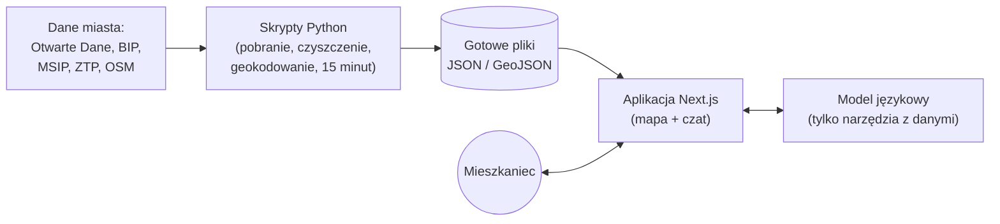

# Oswój Kraków

**Nowy w Krakowie? Zapytaj własnymi słowami.**
Asystent AI i mapa dla nowych mieszkańców Krakowa – odpowiedzi tylko z oficjalnych danych miasta, zawsze z linkiem do źródła.

🔗 **Demo:** [oswoj-krakow.vercel.app](https://oswoj-krakow.vercel.app) · języki: polski (domyślnie), ukraiński, angielski
🏆 Projekt na konkurs **Open Data App 2026** (Gmina Miejska Kraków)


📄 **Dokumenty konkursowe:** [opis projektu](docs/opis.md) · [technologie](docs/tech/technologie.md) · [dane](docs/tech/dane.md) · [architektura](docs/tech/architektura.md) · [asystent AI](docs/tech/ai.md) · [możliwości rozwoju](docs/tech/rozwoj.md)

---

## Dla kogo i po co

Do Krakowa co roku przeprowadzają się tysiące osób – z innych miast Polski i z zagranicy. Na początku muszą załatwić sprawy w urzędzie (zameldowanie, PESEL, rejestracja auta), znaleźć żłobek, przedszkole lub szkołę i zrozumieć komunikację miejską.

„Oswój Kraków” zbiera te informacje w jednym miejscu. Pytasz tak, jak mówisz na co dzień. Dostajesz konkretną odpowiedź z oficjalnej karty usługi i widzisz na mapie, gdzie załatwisz sprawę.

## Problem

- Na koniec 2025 r. w Krakowie było zameldowanych **ponad 15 tys. cudzoziemców** na pobyt czasowy i **ok. 5,8 tys.** na pobyt stały – to obywatele **ponad 130 państw** (Otwarte Dane Miasta Krakowa, stan na 31.12.2025).
- W BIP Kraków jest **639 kart usług**. Trudno wiedzieć, której szukać i jak się nazywa sprawa po polsku.
- Informacje są rozproszone: karty usług w BIP, zbiory na portalu Otwarte Dane, mapy MSIP i ZTP. Każde źródło trzeba znać i umieć przeczytać osobno.

Efekt: wizyty w urzędzie bez kompletu dokumentów, stracony czas po obu stronach okienka i trudniejszy start w nowym mieście.

## Rozwiązanie

Aplikacja webowa, która łączy asystenta AI z interaktywną mapą. Ma trzy moduły:

### 💬 Asystent
Pytasz po polsku, ukraińsku lub angielsku. Asystent odpowiada **wyłącznie na podstawie oficjalnych kart usług BIP**: wymagane dokumenty, opłaty, termin załatwienia i link do umówienia wizyty online. Każda odpowiedź ma odnośnik do karty źródłowej. Punkty obsługi od razu pojawiają się na mapie.

### 🗺️ Kraków w 15 minut
Wpisujesz adres – np. wynajmowanego mieszkania – albo klikasz na mapie i widzisz, co masz w zasięgu 15 minut pieszo lub komunikacją miejską: żłobki, przedszkola, szkoły, parki, biblioteki, przystanki, urzędy – z czasem dojścia do każdego miejsca. Aplikacja wylicza też **Indeks 15 minut** (0–100), a widok można udostępnić linkiem.

Na mapie całego miasta warstwa **„Indeks 15 minut – całe miasto”** pokazuje, gdzie brakuje usług w zasięgu spaceru, a warstwa **dzielnic** – liczbę mieszkańców, cudzoziemców i placówek w każdej dzielnicy.


### ✅ Pierwsze kroki
Lista spraw do załatwienia we właściwej kolejności, dobrana do Twojej sytuacji, z linkami do kart usług. Wystarczy opisać swoją sytuację w czacie. Asystent ma 8 scenariuszy w trzech językach, m.in. dla osób, które:

- przeprowadzają się z innego miasta w Polsce,
- są obywatelami UE,
- są cudzoziemcami spoza UE,
- są obywatelami Ukrainy,
- przyjeżdżają z dziećmi,
- szukają pracy,
- mają samochód,
- przyjeżdżają na studia.

## Przykład

> Andrij przyjechał z Charkowa z pięcioletnią córką. Pisze po ukraińsku: *„Де отримати PESEL і що взяти з собою?”* (czyli: „Gdzie dostanę PESEL i co mam ze sobą zabrać?”)
>
> Asystent odpowiada po ukraińsku, ale podaje polskie nazwy urzędowe w oryginale – żeby Andrij mógł się nimi posłużyć w urzędzie. Wymienia dokumenty i opłatę z karty usługi BIP, daje link do zapisu online i pokazuje na mapie punkty obsługi z godzinami pracy.
>
> Potem Andrij wpisuje adres mieszkania i sprawdza w „Kraków w 15 minut”, które przedszkola i przystanki ma blisko domu.

## Dane, z których korzystamy

| Źródło | Do czego służy |
|---|---|
| **Otwarte Dane Miasta Krakowa** – lista usług administracyjnych z kartami BIP | indeks wszystkich 639 spraw, które można załatwić w mieście |
| **BIP Kraków** – karty usług (XML) | dokumenty, opłaty, terminy, miejsca obsługi i linki do zapisu – podstawa odpowiedzi asystenta |
| **Otwarte Dane** – przedszkola, szkoły podstawowe i ponadpodstawowe, żłobki, kluby dziecięce, kluby rodziców, biblioteki, parki | warstwy na mapie i „Kraków w 15 minut” |
| **Otwarte Dane** – mieszkańcy i cudzoziemcy według dzielnic | skala problemu i profil dzielnic |
| **MSIP** – punkty adresowe EMUiA, granice dzielnic | wyszukiwanie adresów (geokodowanie) i przypisanie miejsc do dzielnic |
| **ZTP** – rozkłady GTFS, przystanki, P+R | dojazd komunikacją miejską w „Kraków w 15 minut” |
| **OpenStreetMap / OpenFreeMap** | podkład mapy, sieć pieszych dróg, kształty parków |

Najważniejsze jest **łączenie tych źródeł**. Przykład: sprawa (karta BIP) → wydział urzędu → adres (EMUiA) → punkt na mapie → dostępność z domu użytkownika (GTFS + OSM). Albo: adres → strefa 15 minut → placówki → indeks dostępności.

## Dlaczego to ważne dla Krakowa

- **Mniej wizyt z niekompletnymi dokumentami.** Mieszkaniec przychodzi do urzędu przygotowany.
- **Łatwiejsza integracja nowych mieszkańców** – w ich języku, ale z oficjalnymi polskimi nazwami spraw.
- **Mapa luk w usługach publicznych.** Indeks „Kraków w 15 minut” pokazuje, gdzie brakuje np. żłobków czy przedszkoli w zasięgu spaceru.
- **Łatwe wdrożenie.** Aplikację można osadzić w serwisach miejskich, na stronach uczelni i u pracodawców.
- **Do przeniesienia do innych miast**, które publikują podobne dane.

Projekt wpisuje się w ideę Smart City i cyfryzacji usług publicznych ze Strategii Rozwoju Krakowa „Tu chcę żyć. Kraków 2030”.

## Jak to działa (w skrócie)



- **Aplikacja:** Next.js (TypeScript) na Vercel, mapa MapLibre.
- **Dane:** skrypty w Pythonie pobierają dane z oficjalnych źródeł i zapisują je jako statyczne pliki. Nie ma osobnej bazy danych.
- **AI:** model językowy przez Vercel AI SDK z łańcuchem zapasowych dostawców (Infercom, Google Gemini, Groq). Model odpowiada **tylko na podstawie wyników narzędzi** (karty BIP, dane miasta) i podaje źródła. Jeśli danych brak – mówi o tym wprost. Ewaluacja: 97% z 60 pytań w trzech językach ([raport](evals/report.md)).
- **Prywatność:** bez kont użytkowników, bez przechowywania danych osobowych.

## Uruchomienie

**Online:** [oswoj-krakow.vercel.app](https://oswoj-krakow.vercel.app) – strona główna `/pl`, mapa i asystent `/pl/mapa`.

**Lokalnie** (wymaga Node.js 24 LTS i npm):

```bash
git clone https://github.com/grabych-jr3/oswoj-krakow.git
cd oswoj-krakow/app
npm ci
cp .env.example .env.local   # tu wpisz klucz API modelu (np. INFERCOM_API_KEY lub GOOGLE_GENERATIVE_AI_API_KEY)
npm run dev                  # http://localhost:3000 → /pl
```

- **Bez kluczy API:** ustaw w `.env.local` wartość `LLM_MOCK=1`. Czat odpowiada wtedy testowymi odpowiedziami, a mapa, warstwy i „Kraków w 15 minut” działają w pełni (nie korzystają z modelu).
- **Wersja produkcyjna lokalnie:** `npm run build && npm start`.
- **Testy i kontrola jakości:** `npm run check` (lint, typy, testy jednostkowe, walidacja plików danych).

**Aktualizacja danych** (wymaga Pythona 3.12 z [uv](https://docs.astral.sh/uv/); do „15 minut” także JDK 21+). Gotowe dane są w repozytorium, więc do uruchomienia aplikacji ten krok nie jest potrzebny.

- dane przestrzenne: `pipeline/geo` – kolejność poleceń w [docs/tech/dane.md, pkt 7](docs/tech/dane.md#7-jak-odtworzyć-dane);
- baza wiedzy BIP: `pipeline/kb` – polecenia w [pipeline/kb/README.md](pipeline/kb/README.md);
- na koniec `cd app && npm run validate:data` sprawdza, czy nowe pliki zgadzają się z kontraktami.

## Dokumentacja

| Dokument | Zawartość |
|---|---|
| [Opis projektu](docs/opis.md) ([PDF](docs/opis.pdf)) | problem, rozwiązanie, funkcje, dane, wartość dla miasta, potencjał wdrożeniowy |
| [Technologie](docs/tech/technologie.md) | z czego zbudowana jest aplikacja i dlaczego |
| [Dane](docs/tech/dane.md) | źródła, przetwarzanie, jakość, licencje, odtworzenie danych |
| [Architektura](docs/tech/architektura.md) | schematy systemu, przepływ pytania i „15 minut”, bezpieczeństwo |
| [Asystent AI](docs/tech/ai.md) | baza wiedzy, narzędzia, ochrona przed halucynacjami, ewaluacja |
| [Możliwości rozwoju](docs/tech/rozwoj.md) | wdrożenie w mieście, nowe dane i funkcje, model biznesowy |

Cała dokumentacja techniczna w jednym pliku: [docs/dokumentacja-techniczna.pdf](docs/dokumentacja-techniczna.pdf). Plan prac zespołu (po ukraińsku): [PLAN.md](PLAN.md).

## Zespół i konkurs

- **Zespół:** 3 osoby.
- **Konkurs:** Open Data App 2026, organizowany przez Gminę Miejską Kraków.
- Tekst zgłoszenia konkursowego: [docs/zgloszenie.md](docs/zgloszenie.md).

## Źródła danych i licencje

- Źródło danych: **Gmina Miejska Kraków, [otwartedane.um.krakow.pl](https://otwartedane.um.krakow.pl)** (portal Otwarte Dane Miasta Krakowa). Dane pobrane 19–21.10.2026; datę „stan danych na” każdego zbioru pokazujemy przy każdym miejscu na mapie.
- Karty usług: **BIP Kraków** – każda odpowiedź asystenta zawiera link do karty.
- Punkty adresowe i dzielnice: **MSIP Kraków**. Komunikacja miejska: **ZTP Kraków**.
- Mapa: © [OpenStreetMap contributors](https://www.openstreetmap.org/copyright) (ODbL), OpenFreeMap.

Szczegóły – źródła, przetwarzanie, jakość i licencje danych: [docs/tech/dane.md](docs/tech/dane.md). Jak pobrać i przeliczyć dane od nowa: [docs/tech/dane.md, pkt 7](docs/tech/dane.md#7-jak-odtworzyć-dane).

Oswój Kraków to serwis informacyjny, a nie porada prawna. W razie wątpliwości obowiązuje treść karty usługi w BIP.
