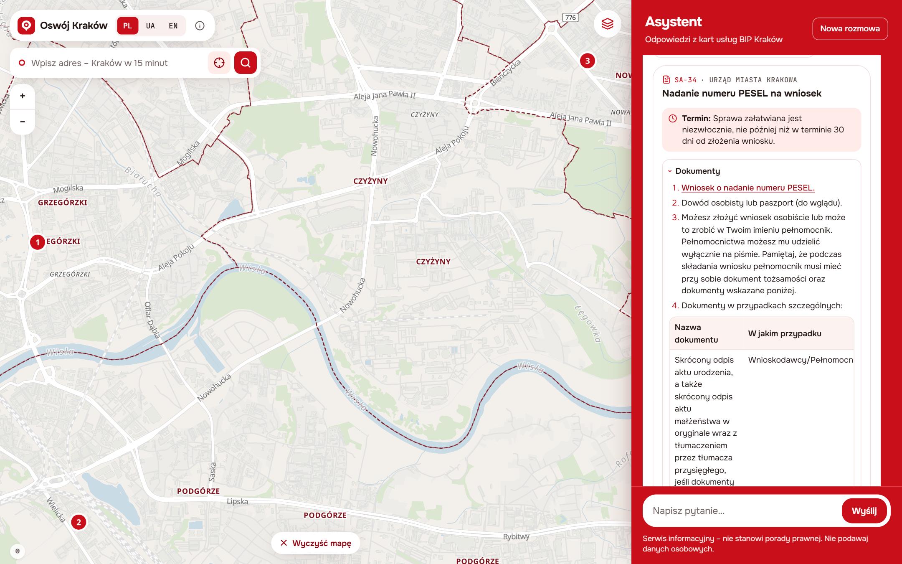
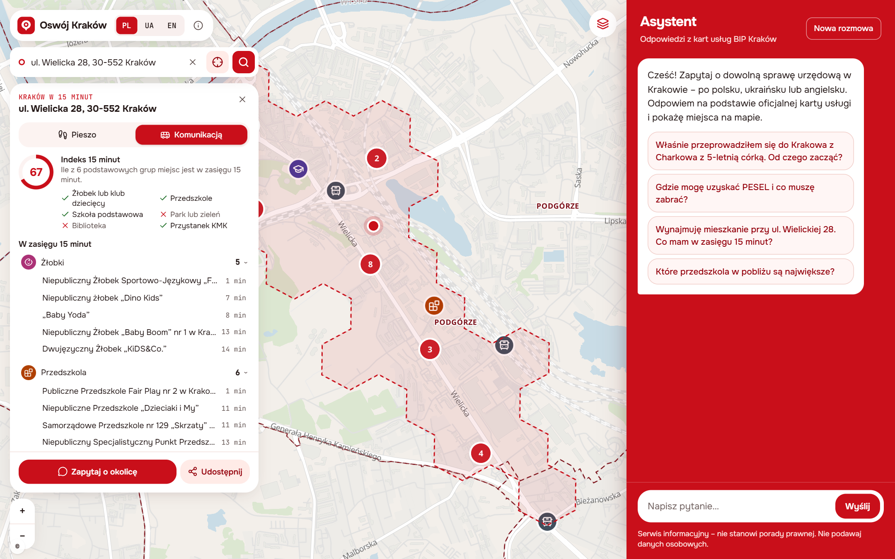

# Oswój Kraków – asystent AI dla nowych mieszkańców Krakowa

**Demo:** [oswoj-krakow.vercel.app](https://oswoj-krakow.vercel.app) · **Kod:** [github.com/grabych-jr3/oswoj-krakow](https://github.com/grabych-jr3/oswoj-krakow) · polski, ukraiński, angielski

## 1. Problem

Do Krakowa co roku przeprowadzają się tysiące osób. Na koniec 2025 r. w mieście było zameldowanych **15 008 cudzoziemców na pobyt czasowy i 5 766 na pobyt stały** – obywateli ponad **130 państw** (Otwarte Dane Miasta Krakowa). Do tego dochodzą osoby z innych miast Polski i studenci. Na początku każdy musi załatwić sprawy w urzędzie (zameldowanie, PESEL, rejestracja auta), znaleźć żłobek, przedszkole lub szkołę i zrozumieć komunikację miejską.

Informacje są rozproszone: **639 kart usług w BIP**, dziesiątki zbiorów na portalu Otwarte Dane, mapy MSIP i ZTP. Trzeba wiedzieć, jak sprawa nazywa się po polsku i której karty szukać. Efekt to wizyty w urzędzie bez kompletu dokumentów i trudniejszy start w nowym mieście.

## 2. Rozwiązanie

Aplikacja webowa, która łączy **asystenta AI** z **interaktywną mapą**. Pytasz własnymi słowami, w swoim języku. Asystent odpowiada **wyłącznie na podstawie oficjalnych danych miasta** – kart usług BIP i danych przestrzennych – i zawsze podaje link do źródła. To, czego dotyczy odpowiedź, od razu widać na mapie.

## 3. Dla kogo

Dla wszystkich nowych mieszkańców Krakowa: cudzoziemców (spoza UE, z UE, obywateli Ukrainy), osób przeprowadzających się z innych miast Polski, rodzin z dziećmi, studentów i osób zaczynających pracę. Pośrednio – dla urzędników, którzy obsługują lepiej przygotowanych interesantów, i dla miasta, które widzi, gdzie brakuje usług.

## 4. Kluczowe funkcje

- **Asystent AI.** Pytanie „Gdzie mogę uzyskać PESEL i co muszę zabrać?” daje kartę usługi z BIP: dokumenty, opłaty, termin, wydziały z godzinami pracy i link do zapisu na wizytę. Wydziały pojawiają się na mapie z numerami. Odpowiedź jest w języku użytkownika, a polskie nazwy urzędowe zostają w oryginale – żeby można się nimi posłużyć w urzędzie.
- **Pierwsze kroki.** Dla sytuacji życiowej („przeprowadziłem się z Charkowa z 5-letnią córką”) asystent daje listę spraw we właściwej kolejności – 8 scenariuszy w 3 językach, każdy krok z kartą BIP.
- **Kraków w 15 minut.** Po wpisaniu adresu lub kliknięciu na mapie aplikacja pokazuje strefę dostępną w 15 minut **pieszo lub komunikacją miejską**, policzone miejsca (żłobki, przedszkola, szkoły, parki, biblioteki, przystanki, urzędy) z czasem dojścia oraz **Indeks 15 minut** (0–100). Widok można udostępnić linkiem.
- **Mapa miasta.** 12 warstw (2 368 miejsc), 18 dzielnic ze statystykami mieszkańców i cudzoziemców oraz **Indeks 15 minut dla całego miasta** – mapa luk w dostępności usług.

## 5. Wykorzystane dane

| Źródło | Zbiory | Zastosowanie |
|---|---|---|
| **Otwarte Dane Miasta Krakowa** | lista usług administracyjnych z kartami BIP; żłobki, kluby dziecięce, przedszkola, szkoły podstawowe i ponadpodstawowe, kluby rodzica, biblioteki, parki, parki kieszonkowe; mieszkańcy i cudzoziemcy według dzielnic i obywatelstw | baza wiedzy asystenta, warstwy mapy, statystyki dzielnic |
| **BIP Kraków** | 639 kart usług (XML): dokumenty, opłaty, terminy, wydziały, rezerwacja wizyt | odpowiedzi asystenta |
| **MSIP** | 70 299 punktów adresowych EMUiA, granice 18 dzielnic | geokodowanie, wyszukiwarka adresów, dzielnice |
| **ZTP Kraków** | rozkłady GTFS (autobusy, tramwaje), przystanki, P+R | dojazd komunikacją w „15 minutach” |
| **OpenStreetMap** | sieć dróg pieszych, kształty parków, podkład mapy | trasy piesze, mapa |

**Łączymy źródła ze sobą:** karta usługi (BIP) → wydział → adres (EMUiA) → punkt na mapie → czas dojścia z domu użytkownika (GTFS + OSM). Albo: adres → strefa 15 minut → placówki z Otwartych Danych → indeks dostępności → porównanie z liczbą mieszkańców i cudzoziemców w dzielnicy. Każde miejsce na mapie ma źródło i datę stanu danych.

## 6. Wartość dla miasta i mieszkańców

- **Mniej wizyt z niekompletnymi dokumentami** – mieszkaniec przychodzi przygotowany, z właściwą kartą i terminem.
- **Łatwiejsza integracja** – informacja w języku mieszkańca, ale z oficjalnymi polskimi nazwami spraw.
- **Mapa luk w usługach** – Indeks 15 minut pokazuje, gdzie brakuje żłobków, przedszkoli, bibliotek czy zieleni w zasięgu spaceru; to argument przy planowaniu inwestycji.
- **Zaufanie** – asystent nie zmyśla: odpowiada tylko z danych, linkuje źródło, a gdy danych brak, mówi to wprost. W teście 60 pytań w 3 językach 97% odpowiedzi opierało się na właściwych narzędziach i źródłach.
- Projekt wpisuje się w Strategię Rozwoju Krakowa „Tu chcę żyć. Kraków 2030” (Smart City, cyfrowe usługi publiczne).

## 7. Potencjał wdrożeniowy i biznesowy

- **Gotowe do pilotażu:** działa w przeglądarce, bez instalacji i bez kont; dostępność WCAG (Lighthouse 100). Można osadzić w serwisach miejskich, w Centrum Obsługi Mieszkańców, na stronach uczelni i pracodawców.
- **Niskie koszty:** brak bazy danych, hosting statyczny, model językowy wymienny konfiguracją (darmowy lub płatny plan, także model miasta).
- **Skalowalność:** otwarte standardy (GTFS, GeoJSON, H3, OSM) – przeniesienie do innego miasta to nowe źródła w potokach danych.
- **Model biznesowy:** licencja dla miast i gmin (B2G), pakiet relokacyjny dla pracodawców i uczelni (B2B), widżet „Indeks 15 minut” dla portali nieruchomości.

## 8. Zespół

Trzyosobowy zespół z podziałem na trzy obszary: **dane i analiza przestrzenna** (potoki danych, geokodowanie, „15 minut”), **asystent AI i baza wiedzy** (karty BIP, scenariusze, ewaluacja), **aplikacja i UX** (mapa, czat, dostępność, wdrożenie). Kod jest publiczny, a dokumentacja techniczna opisuje technologie, dane, architekturę i możliwości rozwoju.
