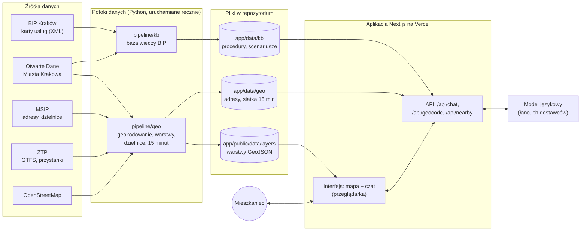
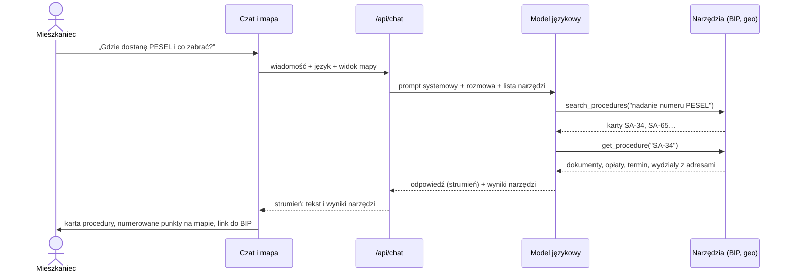
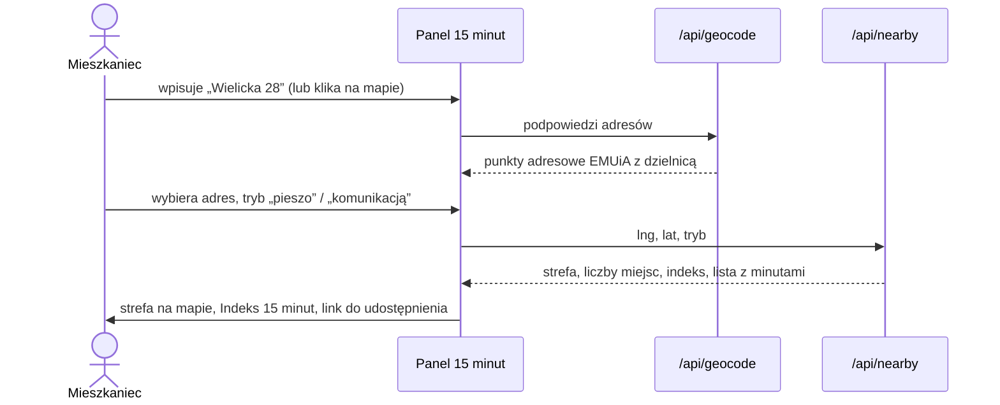
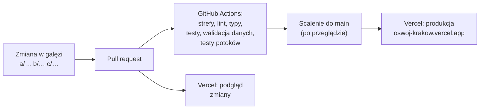

# Architektura

Oswój Kraków składa się z trzech części: **potoków danych** (Python), które raz przetwarzają dane miasta, **aplikacji** (Next.js), która je pokazuje i udostępnia przez API, oraz **asystenta AI**, który odpowiada wyłącznie na podstawie tych danych.

## 1. Schemat ogólny

Najważniejsza decyzja: **dane są przygotowane z góry**. Aplikacja w czasie działania nie pobiera nic z serwisów miasta, nie ma bazy danych i nie liczy tras. Czyta gotowe pliki, dlatego jest szybka, tania i odporna na awarie zewnętrznych serwisów. Aktualizacja danych to ponowne uruchomienie potoków ([dane.md, pkt 7](dane.md#7-jak-odtworzyć-dane)).

## 2. Moduły

| Moduł | Katalog | Zadanie |
|---|---|---|
| Potok bazy wiedzy | `pipeline/kb` | lista 639 usług z Otwartych Danych → karty XML z BIP → tekst, tagi sytuacji życiowych, waga dla nowych mieszkańców; scenariusze „Pierwsze kroki” w 3 językach |
| Potok danych przestrzennych | `pipeline/geo` | geokodowanie placówek do punktów adresowych EMUiA, 12 warstw miejsc (2 368 obiektów), 18 dzielnic ze statystykami, czasy dojścia na siatce H3 |
| Kontrakty | `app/src/contracts` | schematy `zod` wspólne dla wszystkich modułów: miejsce, dzielnica, procedura, scenariusz, wynik „15 minut”, wyniki narzędzi asystenta |
| Serwis geo | `app/src/server/geo` | geokoder (autouzupełnianie adresów), wyszukiwanie miejsc, „15 minut” – odczyt z plików |
| Asystent | `app/src/server/agent` | prompt, narzędzia, wyszukiwarka MiniSearch, łańcuch modeli, limity |
| Interfejs | `app/src/components`, `app/src/map` | mapa i warstwy, czat i karty wyników, panel „Kraków w 15 minut”, analiza miasta |

Moduły rozmawiają ze sobą tylko przez kontrakty i publiczne wejścia (`@/server/geo`). Zmiana formatu po jednej stronie jest wykrywana podczas kompilacji i w CI, zanim trafi do użytkownika.

## 3. Pytanie do asystenta

Interfejs nie przepisuje faktów z tekstu modelu. **Karta procedury, lista miejsc i znaczniki na mapie są rysowane wprost z wyników narzędzi**, sprawdzonych schematem `zod` w przeglądarce. Numery w tekście („(1)”, „(2)”) są klikalne i pokazują miejsce na mapie. Szczegóły asystenta: [ai.md](ai.md).

## 4. „Kraków w 15 minut”

Serwer przypisuje punkt do heksagonu siatki H3 (poziom 9) i odczytuje wynik policzony wcześniej silnikiem R5 na rozkładach ZTP i sieci OpenStreetMap. Odpowiedź zajmuje poniżej milisekundy i nie zależy od zewnętrznych serwisów tras. Ta sama siatka zasila warstwę „Indeks 15 minut – całe miasto”, która pokazuje, gdzie brakuje usług.

## 5. Interfejs

- **Jedna strona mapy** (`/[język]/mapa`): mapa na cały ekran, po prawej kolumna czatu (na komputerze z regulowaną szerokością, na telefonie jako wysuwany arkusz).
- **Szyna czat ↔ mapa:** odpowiedź asystenta rysuje numerowane znaczniki, strefę i punkt startowy, a mapa dopasowuje widok. Z karty miejsca na mapie można zapytać asystenta o to miejsce. Wybrany na mapie adres trafia do asystenta jako kontekst.
- **Warstwy:** 12 kategorii miejsc z klastrowaniem, dzielnice ze statystykami, „Indeks 15 minut” dla całego miasta. Dane warstw ładują się dopiero po włączeniu.
- **Udostępnianie:** widok „15 minut” ma własny adres URL (`/pl/mapa?lng=…&lat=…&mode=…`).
- **Języki:** wszystkie teksty interfejsu w plikach tłumaczeń (polski, ukraiński, angielski). Dane miasta i nazwy urzędowe zostają po polsku – tak, jak w urzędzie.

## 6. Bezpieczeństwo i prywatność

- Brak kont użytkowników i brak zapisu rozmów po stronie serwera.
- Klucze API tylko w zmiennych środowiskowych serwera; repozytorium jest publiczne i nie zawiera sekretów.
- Limit zapytań do asystenta na adres IP. Model nie prosi o dane osobowe i ich nie powtarza.
- Linki zewnętrzne w odpowiedziach tylko do oficjalnych serwisów (BIP i biała lista instytucji państwowych). Odpowiedzi nie zawierają HTML ani skryptów.
- Tylko dwa techniczne ciasteczka: wybrany język interfejsu i informacja, że użytkownik zamknął okno powitalne. Bez analityki i śledzenia.

## 7. Wdrożenie i jakość

- Trzy obszary odpowiedzialności (dane, asystent, aplikacja) mają osobne katalogi; CI sprawdza, czy zmiana nie wychodzi poza swój obszar.
- Każda zmiana przechodzi testy jednostkowe (aplikacja i potoki), walidację plików danych schematami oraz przegląd kodu.
- Gotowe dane są w repozytorium, więc wdrożenie nie wymaga uruchamiania potoków na serwerze.
